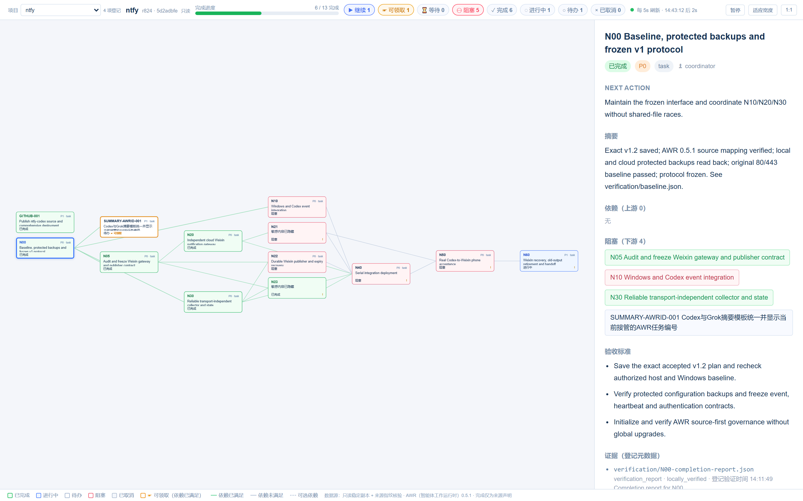

# AWR 只读依赖进度看板

这是 AWR（Agent Work Runtime，智能体工作运行时）0.5.1 的本地外置看板。它将已登记项目的工作项、依赖、来源状态和领取信息展示为编号分组泳道时间线、分组依赖图和旧版依赖图，支持项目选择、筛选、平移、缩放、定位、关联高亮、暂停和每 5 秒刷新。

看板独立运行，不修改上游 AWR，不执行、领取或编辑被查看项目的工作项，也不会自动重新索引来源。服务只监听 `127.0.0.1`，网页只允许查看本地清单中已经登记的项目。

## 界面截图

下图为早期版本选中 ntfy 项目并点击任务后的依赖图效果：顶栏显示完成进度与状态筛选，中间是工作项依赖图，点击任务后右侧显示任务详情。当前版本默认打开时间线视图，依赖图另按编号分组加框，见下文“三种视图”。



## 快速开始

需要 Node.js 24 或更新版本。当前支持依据为 Windows、AWR 0.5.1 和数据库结构版本 7；其他版本或操作系统没有等同的完整验收依据，未知数据库结构会被明确拒绝。

在克隆后的仓库根目录打开普通用户终端：

```powershell
npm ci
if (Test-Path -LiteralPath '.\config\projects.json') {
    throw '本地项目清单已存在，请核对现有内容，不要覆盖。'
}
Copy-Item -LiteralPath '.\config\projects.example.json' -Destination '.\config\projects.json'
npm start -- --port 4317
```

打开 [本地看板](http://127.0.0.1:4317/)。初始清单为空，页面等待选择；请按 [安装与运行说明](docs/installation.md) 登记已有的 AWR 项目。看板不会初始化项目或扫描磁盘。在前台终端按 `Ctrl+C` 停止。

如端口已占用，可使用 `npm start -- --port 4318`，不要结束未知进程。可选的 Windows 登录后后台部署、账户绑定、迁移步骤和测试条件也见 [安装与运行说明](docs/installation.md)。

## 项目选择与页面操作

本地文件 `config/projects.json` 是本看板自己的允许名单。网页提供选择和查看，不提供登记增删。名单变化在下一轮检查时生效，无需重启；不同标签页可以查看不同项目。

- 点击状态按钮筛选；再点击同一按钮恢复全部。完成进度和计数仍按整个项目统计。
- 拖动画布空白处平移，滚轮缩放；“适应宽度”重新居中，“1:1”恢复原始尺寸。
- “暂停”停止图读取，项目名单仍继续检查；暂停时切换项目允许读取新目标一次。“恢复”立即重读。
- 拖动详情栏左缘可调整详情宽度。

读取失败会保留最后成功的图并明确标记旧数据；切换到尚未成功读取的项目时显示错误空态。5 秒是页面轮询节拍，浏览器节流、文件持续变化和来源尚未重新索引都可能延后结果。

### 三种视图

画布右下角的视图切换按钮在三种视图间切换。所选视图写入地址栏（`#view=timeline`、`#view=graph`、`#view=classic`）并记在浏览器本地，可直接收藏对应链接；切换视图不改变项目、筛选、详情或高亮。

- **时间线**（默认）：每行一个编号分组的泳道，横轴为任务的真实活动日期；没有活动记录的任务排在左侧未定日期区。进行中且超过 7 天无活动的任务标注“停滞”。顶部“总览”列出各编号分组完成率、停滞任务和近 7 天有活动的任务，可收起；点击总览中的任务打开其详情，点击分组定位到对应泳道。
- **依赖图**：按依赖关系分层排列，每个编号分组画一个框。
- **旧版看板**：改版前的分层依赖图，原坐标、不分组、无总览，供对照使用。

编号分组只是按工作编号字面前缀归类的展示方式，不代表业务线：普通键直接作为编号；AWR 自动生成的 `WORK-哈希` 键改取标题开头的编号（如“`STREAM-REUSE-001` …”）。编号第一段去掉末尾数字并转大写即为分组名，如 `STREAM-REUSE-001` → `STREAM`；互为前缀的分组名并入较短者（较短者至少 4 个字符），如 `DASHBOARD` 并入 `DASH`。只有一项或没有可辨认编号的任务归入“零散任务”。需要调整时可在本地清单中为项目添加可选的 `lanes` 覆盖，见 [安装与运行说明](docs/installation.md#可选编号分组覆盖)。

### 查看详情与高亮关联任务

三种视图使用同一套操作：

| 操作 | 效果 |
| --- | --- |
| 单击任务 | 在右侧显示下一步、必要前置项、下游、验收标准、证据登记信息与有效认领；不改变高亮。 |
| 双击任务 | 高亮该任务及其直接上下游，淡化其余任务，并同时显示该任务详情。 |
| 再次双击已高亮的任务 | 取消高亮，详情保留。 |
| 双击另一任务 | 改为高亮该任务。 |
| `Esc`，或单击时间线泳道、依赖图、旧版看板的画布空白处 | 同时清除详情与高亮。拖动平移画布不会清除。 |
| 单击详情中的邻接项或总览条目 | 定位并显示该任务详情，不改变高亮。 |

详情所选任务始终保持清晰显示，不随高亮淡化。

### 运行中提示

当某个任务的有效认领绑定到本机正在执行回合的 Claude Code、Codex 或 Grok 会话时，对应进行中的任务卡外圈显示旋转光环，时间线中的任务条显示运行标记（悬停提示“有智能体正在执行”）；会话空闲、回合结束或进程退出后，经短暂宽限熄灭。系统设置为减少动态效果时光环不旋转。

该提示只在 Windows 上由看板服务以当前用户权限观察：读取上述三种客户端进程的创建时间与存活状态，以及本用户目录下 `.claude`、`.codex`、`.grok` 中会话注册与日志文件的结构字段和尾部状态，用于判断是否正在执行。观察只读，不复制消息或命令正文，不读取进程内存或环境，不写入这些客户端文件；首次使用时会在系统临时目录编译并缓存一个小型探针程序。运行中提示只是展示，不表示认领有效，也不代表任务进度。

## 状态含义与只读边界

“完成”表示权威来源声明完成，不等于证据验收或业务上线。“可领取”只是已知版本依赖条件下的展示提示，不是执行许可。“继续”不表示当前查看者拥有领取权。

看板核对登记来源、适配器、解析配置和原始字节指纹。来源已变更、缺失或无法核验时，页面显示上次索引投影并停止肯定的领取提示。需要更新索引时，在原项目的正常协作流程中处理。

数据库查询只在项目外、自有临时目录中的稳定副本上执行；不打开原数据库连接、不复制原共享内存侧文件、不恢复原日志。异常、持续变化或不兼容的文件明确失败。当前支持项目根内普通文件来源：`markdown-heading-v1`、`markdown-rules-v1`、`markdown-ledger-v1`、`yaml-ledger-v1`、`yaml-workstream-ledger-v1`；不支持目录、Git 定位符、越界来源或来源链接跳转。

读取限制为数据库与日志合计 64 二进制兆字节、单来源 8 二进制兆字节、最多 1000 个真实工作项、响应 8 二进制兆字节。超限会失败，不截断成看似完整的结果。

服务只提供受限读取接口，不提供写入、下载、任意路径、重新索引或执行接口。证据只展示登记文字，不读取或执行目标。来源文字按纯文本显示，并保守隐藏识别出的敏感内容；该检测可能误报或漏报，本地监听也不等于对同机其他程序进行身份认证。

## 本地配置与验证

仓库只提供 [空项目清单示例](config/projects.example.json) 和 [后台绑定格式示例](ops/background-settings.example.json)。真实清单、账户标识、Node.js 安装路径、运行日志、治理记录、历史验收和本地依赖不应提交。

```powershell
npm test
npm run test:projects
npm run test:background
```

单项浏览器检查可单独运行，例如 `npm run test:halo`（运行中光环）、`npm run test:titles`、`npm run test:panel-ui`、`npm run test:favicon`；关联高亮的双击检查为 `node --no-warnings tests/focus-toggle-browser.mjs`。它们使用夹具项目与临时端口，报告写入被版本控制忽略的 `verification/`。

这些是现有验证入口，不是仅安装 Node.js 后便能完整运行的承诺。Windows 完整测试还需要普通权限、Windows PowerShell 5.1、可执行的 `pwsh.exe`、本地生成的后台绑定、Chrome，以及历史原生测试所用的固定 MinGW 工具链。具体条件和结果边界见 [验证说明](docs/installation.md#验证条件与结果边界)。

`ops/native/`、原生构建脚本和对应测试保留为历史实现；当前登录后后台方案不部署原生降权启动器。测试通过不能代替真实登录触发或长期后台运行验收。
